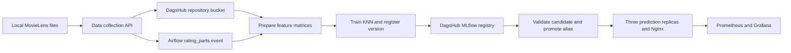

# Movie Recommender — MLOps training project

An end-to-end MLOps learning project completed by a four-person team during
Liora's Machine Learning Engineering training. It demonstrates data versioning,
containerized model training and serving, orchestration, authenticated APIs, and
operational monitoring using MovieLens data.

This is Ali's independent personal copy. The original [team repository](https://github.com/rosneru/sep26_bmlops_movie_reco)
and [DataScientest template](https://github.com/DataScientest-Studio/Template_MLOps_movie_recommandation)
retain their attribution and commit history. The MIT license is unchanged.
Original repositories are read-only references; all writes belong in the personal
[GitHub](https://github.com/abulhawa/movie-recommender-mlops) and
[DagsHub](https://dagshub.com/abulhawa/movie-recommender-mlops) repositories.
See [preservation details and historical gaps](PRESERVATION.md).

## Start here

| Goal | Guide |
|---|---|
| Restore a clone on a new machine | [Restore and operate the project](docs/RESTORE_AND_RUN.md) |
| Understand model/data rollback and legacy migration | [Versioned serving bundles](docs/VERSIONED_SERVING_DATA.md) |
| Understand the components and code | [Architecture and code map](docs/ARCHITECTURE.md) |
| Prepare data, train, and deploy with Airflow | [Airflow guide](airflow/README.md) |
| Train ALS and the interaction-based hybrid two-tower | [Interaction retrieval](docs/INTERACTION_RETRIEVAL.md) |
| Evaluate future recommendations and inspect development results | [Offline evaluation](docs/RECOMMENDATION_EVALUATION.md) |
| Read model behavior and evaluation limitations | [Training guide](src/train_service/readme.md) |
| Verify prediction, model versions, and rollback | [Prediction guide](src/predict_service/README.md) |
| Demonstrate requests and dashboards | [Monitoring guide](src/monitoring_service/README.md) |

## What the system does



New registered bundles carry their matching processed data and checksums, so
rolling back a bundled model also restores its user profiles. Older models need
a [one-time transition](docs/VERSIONED_SERVING_DATA.md#existing-models-need-a-one-time-transition) before managed rollout.

The default KNN retrieves neighbors of a user's averaged genre profile. The
profile uses which movies a user rated, not the numeric rating values. A separate
optional two-tower model learns cosine-similarity pseudo-labels. The automated
Airflow training/deployment DAG is specifically for KNN.

Deployment checks validate authentication, the selected model version, and the
shape of a prediction response. They do not measure recommendation ranking
quality. A separate [temporal backtest](docs/RECOMMENDATION_EVALUATION.md) now
measures held-out recommendations against popularity; it does not score an already
leaked live model. There is no quality threshold that blocks model registration. Current
monitoring records requests, latency, authentication results, and availability;
data-drift detection and alert rules are not implemented in this copy.

## Restore, then start

A clone contains the code and configuration templates. It does **not** contain
private credentials, datasets, trained artifacts, or Docker volumes. Follow the
[restore guide](docs/RESTORE_AND_RUN.md) before the first startup. It covers the
password-manager backup, machine-specific settings, DVC access, and model access.

Check local settings without printing values or changing files:

```bash
uv run python airflow/setup_local.py --check
# Also check the serving alias/KNN requirements before deployment:
uv run python airflow/setup_local.py --check --deployment
```

Once those prerequisites are satisfied:

```bash
make start-project
# Equivalent: docker compose up -d --build

docker compose ps
```

Compose starts the APIs, three prediction replicas, Nginx, Airflow/PostgreSQL,
Prometheus, Grafana, and node-exporter. Preparation and training are one-off
profiled jobs; ordinary startup does not execute those jobs directly. Starting
Airflow can resume queued work or scheduling for DAGs that were already unpaused.
To inspect the system without retraining, leave ingestion and training DAGs paused.

Before using the Airflow training DAG, build its sibling-container images:

```bash
docker compose build data-preparation train predict
```

For Airflow-managed deployment, use `MODEL_TYPE=knn`, `PREDICT_MODEL_TYPE=knn`,
and an existing serving alias such as `PREDICT_MODEL_VERSION=@live`. A plain
`latest` selector works for standalone serving but is rejected by the deployment
task. See the [Airflow guide](airflow/README.md) before triggering a run; it
registers a real model version and can restart the serving replicas.

## Local interfaces

| Interface | URL | Login |
|---|---|---|
| Prediction API through Nginx | http://localhost:8000/docs | API account |
| Data collection API | http://localhost:8001/docs | API admin account |
| Airflow | http://localhost:8081 | `AIRFLOW_ADMIN_*` from `.env` |
| Grafana | http://localhost:3000 | `GRAFANA_ADMIN_*` from `.env` |
| Prometheus targets | http://localhost:9090/targets | Local demo interface |
| Model registry | https://dagshub.com/abulhawa/movie-recommender-mlops.mlflow | DagsHub account |

API accounts and Airflow/Grafana accounts are separate. The committed API demo
accounts include `alice` / `alice123` for prediction and `admin` / `admin123`
for ingestion. Custom user files can replace them; see [authentication](src/user_authentication_service/README.md).
A numeric MovieLens profile ID is also separate from the account used to log in.
Choose one from the restored `user_matrix.csv`; an unknown profile returns 404.

The Compose configuration is for a local learning/demo environment. Several host
ports are published beyond loopback, the scheduler has Docker-socket access,
and demo credentials are documented. This is not a ready-made public deployment.
No online hosting is configured by this documentation update.

## Development and tests

Use Python 3.12 or newer; `.python-version` pins local development to 3.12.14.
Application Dockerfiles use Python 3.12 and Airflow uses its own Python 3.13 runtime.
After installing uv:

```bash
uv sync --locked
uv run --offline --frozen pytest -q
```

The default suite uses mocked ingestion and a temporary SQLite MLflow registry.
It does not contact DagsHub. The optional PyTorch test is skipped when PyTorch
is absent. Scripts under `tests/mlflow/` are separate manual server-backed
examples and are excluded from default pytest collection.

[Compose integration](.github/workflows/compose.yml) uses a disposable local
MLflow server, synthetic data, and dummy DagsHub settings. It is separate from the
local pytest suite. Inspect the latest Actions run for its result; a workflow
file alone is not proof that CI passed.

## Stop and keep your work

```bash
make stop-project
# Equivalent: docker compose down
```

This preserves named volumes and host files. Do not add `--volumes` for a normal
stop: that removes local Airflow metadata, Grafana settings, and monitoring history.
DagsHub records are remote and separate. Before deleting the checkout, follow the
[archive checklist](docs/RESTORE_AND_RUN.md#before-deleting-the-local-copy).
